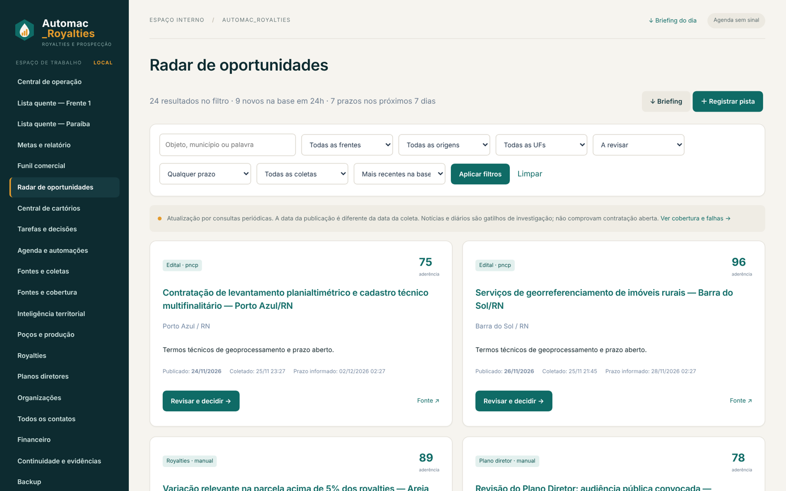
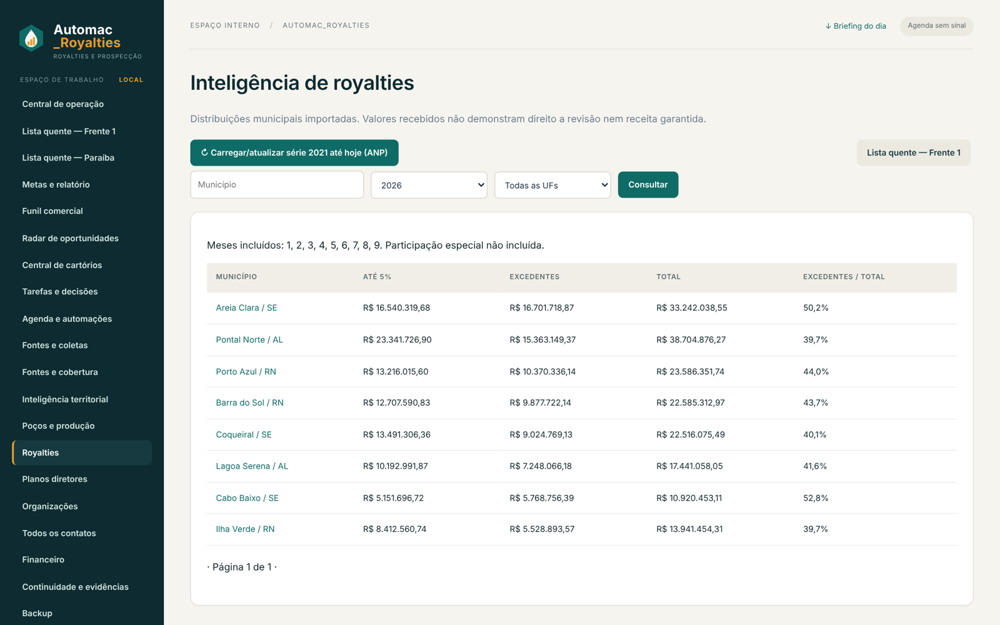
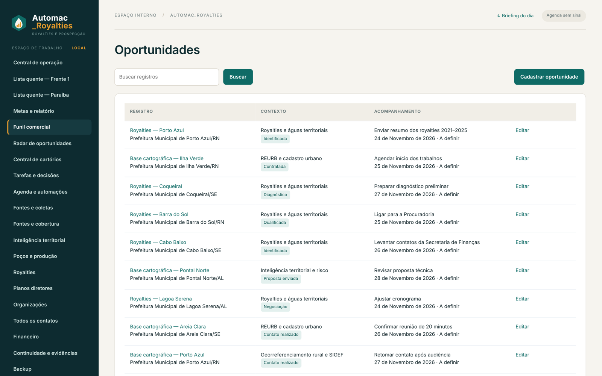
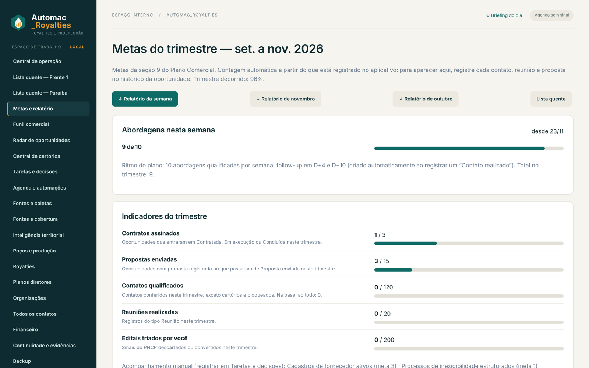

# Automac_Royalties

Aplicativo local para acompanhar royalties de petróleo dos municípios e organizar a prospecção comercial: royalties ANP,
poços e produção, radar de editais (PNCP, Querido Diário), funil de oportunidades e mensagens de abordagem.

Autor e responsável: Roberth Dantas Gomes.

## Telas

Prints feitos com uma base de demonstração: municípios, valores e editais são fictícios.

| | |
| --- | --- |
|  |  |
| Radar de oportunidades: editais e sinais com nota de relevância e prazo | Royalties por município: parcela até 5%, excedentes e total |
|  |  |
| Funil comercial: etapa e próxima ação de cada oportunidade | Metas do trimestre: abordagens, propostas e contratos |

## Como usar no Windows

1. Copie esta pasta para `C:\Automac_Royalties` (fora do OneDrive ou Google Drive).
2. Rode `01_INSTALAR.bat` uma vez e crie sua conta.
3. Para abrir, rode `02_ABRIR.bat`. O app abre em `http://127.0.0.1:8766`.

A porta 8766 e a pasta próprias deixam o Automac_Royalties rodar no mesmo computador que outra instalação do app
original, sem conflito.

## Dados

O banco fica em `aplicativo/dados/` e nunca entra no repositório (veja `.gitignore`). Para levar os dados de um
computador para outro, use o backup e a restauração do próprio app.

## Identidade nas mensagens

O nome que aparece nas mensagens de abordagem e nos relatórios vem de variáveis de ambiente (opcionais):

| Variável | Padrão |
| --- | --- |
| `AUTOMAC_ORG_NAME` | `Automac_Royalties` |
| `AUTOMAC_ORG_TAGLINE` | `Royalties e prospecção` |
| `AUTOMAC_ORG_PLACE` | em branco (cidade/UF) |
| `AUTOMAC_ORG_SITE` | em branco |

## Identidade visual

- Símbolo: hexágono verde-mar com uma gota e três barras crescentes em âmbar (`aplicativo/staticfiles/marca/`).
- Cores: petróleo `#0D2B30`, mar `#0F6B66`, âmbar `#E39A2C`, areia `#F6F4EF`.
- Fontes: Bahnschrift nos títulos e Segoe UI no texto, as duas já instaladas no Windows.
- Estilos em `aplicativo/staticfiles/marca.css`.

## Documentação

- `aplicativo/documentacao/MANUAL_DE_USO.md`: uso do dia a dia.
- `aplicativo/documentacao/ADMINISTRADOR.md`: atualizações, versões e testes.
